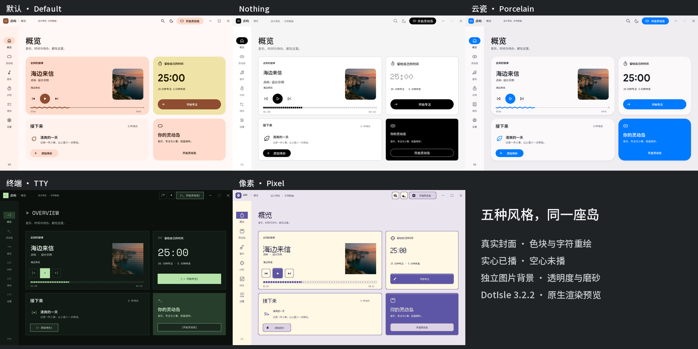
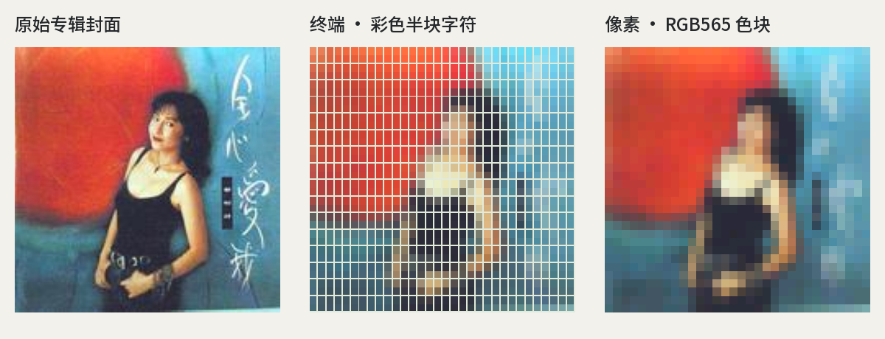

# 点屿 · DotIsle

**把音乐、歌词、专注与提醒，放进 Windows 桌面的一座小岛。**

音乐控制与实时歌词 · 番茄钟与计时 · 待办提醒 · 通知与设备

[下载安装版](https://github.com/Heiamer/DotIsle/releases/download/v3.2.2/DotIsle-3.2.2-Setup.exe) · [下载便携版](https://github.com/Heiamer/DotIsle/releases/download/v3.2.2/DotIsle-3.2.2-Portable.zip) · [3.2.2 更新说明](https://github.com/Heiamer/DotIsle/releases/tag/v3.2.2) · [反馈问题](https://github.com/Heiamer/DotIsle/issues)

Windows 10 / 11 · x64 · Rust 原生应用

## 五套主题，同一套功能

截图来自应用原生渲染；歌曲、歌词与待办为演示数据。点击图片可查看大图。

| 主题 | 风格 |
| --- | --- |
| **默认** | 保留原有配色、布局、图标和窗口行为。 |
| **Nothing** | 黑白工业风、简洁线条图标与点阵计时数字。 |
| **云瓷 · Porcelain** | 暖灰、瓷白、亮蓝，圆润卡片与白色滑钮。 |
| **终端 · TTY** | 等宽字符、方正面板、色块唱片和离散进度。 |
| **像素 · Pixel** | 中英像素字体、16 位机卡带、方块图标与阶梯边框。 |

在 **控制中心 → 设置 → 外观** 选择主题。五个选项块支持点击、拖动和键盘切换，重启后保留选择；四套非默认主题使用固定窗口尺寸。

### 让真实封面变成色块与字符

终端和像素主题都使用正在播放歌曲的真实封面，颜色来自原图；仅在没有封面时显示占位图。转换结果随封面缓存，切歌或封面延迟到达后自动刷新。播放进度采用**已播实心块、未播空心块**，暂停时同样可辨。

### 用自己的图片做背景

在同一页面的 **自定义图片背景** 中选择本机 PNG、JPEG 或 BMP，可分别调整图片透明度、明暗、磨砂度，以及填满 / 适应方式。

每套主题单独保存图片和参数。导入图片会复制到本机数据目录，不上传服务器；关闭背景时仍保留配置，也可恢复默认。背景功能默认关闭。

### 更柔和的展开与收起

展开、收起时加入轻微高斯模糊，静止后恢复清晰；中途反向也能连续过渡。开启“减少动态效果”后关闭过渡模糊。

## 下载与开始使用

最新正式版：**[3.2.2](https://github.com/Heiamer/DotIsle/releases/tag/v3.2.2)**。发行包由 [GitHub Actions](https://github.com/Heiamer/DotIsle/actions/workflows/windows-release.yml) 编译，运行时不需要安装 Rust、Python 或 .NET。

| 文件 | 用途 |
| --- | --- |
| [安装版 · Setup.exe](https://github.com/Heiamer/DotIsle/releases/download/v3.2.2/DotIsle-3.2.2-Setup.exe) | 推荐使用。标准安装向导，支持开始菜单与卸载。 |
| [便携版 · Portable.zip](https://github.com/Heiamer/DotIsle/releases/download/v3.2.2/DotIsle-3.2.2-Portable.zip) | 免安装，完整解压后运行 `LyricIsland.exe`。 |
| [完整源码 · Source.zip](https://github.com/Heiamer/DotIsle/releases/download/v3.2.2/DotIsle-3.2.2-Source.zip) | 对应发行构建的源码、资源与第三方许可。 |
| [SHA256 校验清单](https://github.com/Heiamer/DotIsle/releases/download/v3.2.2/DotIsle-3.2.2-SHA256.txt) | 校验下载文件是否完整。 |
| [验证记录 · Validation.zip](https://github.com/Heiamer/DotIsle/releases/download/v3.2.2/DotIsle-3.2.2-Validation.zip) | Actions 中的控制中心与主题渲染验收记录。 |

1. 安装，或把便携包**完整解压到可写目录**；不要在压缩包内直接启动 EXE。
2. 运行点屿，从系统托盘打开控制中心。
3. 打开播放器并播放音乐，点屿会尝试连接媒体会话、读取歌曲并匹配歌词。
4. 在控制中心调整灵动岛排版、主题、图片背景与动画；也可直接使用计时和待办。

请保留程序旁的资源、字体、更新助手和许可证。关闭控制中心后，灵动岛继续运行；完全退出主程序后，不再提供计时和待办提醒。

### 从旧版更新

在“关于与更新”检查更新，或手动下载新包。手动迁移时先退出旧版，备份并复制原运行目录的 `Data` 到新目录；不要同时运行两个版本操作同一份数据。

发行页中的 `LyricIsland-3.2.2-Portable.zip` 与对应 SHA256 文件供旧更新器识别，日常下载请使用上表的 DotIsle 包。国内镜像可能晚于 GitHub 更新。

## 能做什么

- **音乐与歌词**：播放 / 暂停、切歌、进度调节、原文与翻译、多种展开排版、封面动态配色。实际控制能力取决于播放器接口。
- **专注与计时**：番茄钟、倒计时、秒表和流程计时，支持多项目与暂停恢复。
- **待办与提醒**：记录、编辑、完成、撤销，以及日期和时间提醒。
- **通知与设备**：在岛体中展示通知与设备连接状态，具体能力受系统、权限及设备接口影响。
- **外观与交互**：五套主题、独立图片背景、明暗模式、灵动岛布局与动画设置。

## 3.2.2 修了什么

- 终端和像素主题从固定唱片 / 卡带占位图改为真实封面重绘，分别使用彩色半块字符与 RGB565 色块。
- 已播、未播进度改用实心和空心两种形态区分，不再只靠接近的颜色。
- 取消网易云固定客户端资源包的哈希白名单，按实际进程与 CEF 窗口能力识别控制通道。
- 默认主题保留原有外观，其他主题的布局、背景和已有功能继续保留。

**网易云兼容范围：** 当前已在 3.1.43.205627 验证连续跳转、快速请求合并、暂停后跳转并保持暂停，以及原进度和播放状态恢复。该客户端仍会产生任务栏注意力请求，保护线程已全部清除；其他版本和窗口场景仍需分别验证，去除版本白名单不等于保证任意布局都兼容。详见[本版发布说明](https://github.com/Heiamer/DotIsle/releases/tag/v3.2.2)。

## 源码与构建

使用 **Rust、Win32、Vello Hybrid、wgpu 与 Parley**。源码包含发行所需字体、资源和第三方补丁，不包含用户数据或编译缓存。

推荐使用仓库的 [Windows Release 工作流](.github/workflows/windows-release.yml) 构建；本地环境与命令见 **[3.2.2 构建说明](BUILD-3.2.2.md)**。本版通过 490 项工作区测试，以及主题、背景和控制中心渲染检查；自动检查不能替代所有播放器与桌面交互场景的实机验证。

## 许可与反馈

项目许可见 [LICENSE](LICENSE)。第三方与字体许可见 [THIRD-PARTY-NOTICES.md](THIRD-PARTY-NOTICES.md)、[FONT-NOTICE.md](FONT-NOTICE.md) 和 [licenses](licenses/)。像素字体使用 Fusion Pixel，随包保留其许可。

欢迎在 [Issues](https://github.com/Heiamer/DotIsle/issues) 提交问题或建议。请附 Windows 版本、点屿版本、播放器版本、复现步骤和相关截图；分享日志前请移除个人信息。
