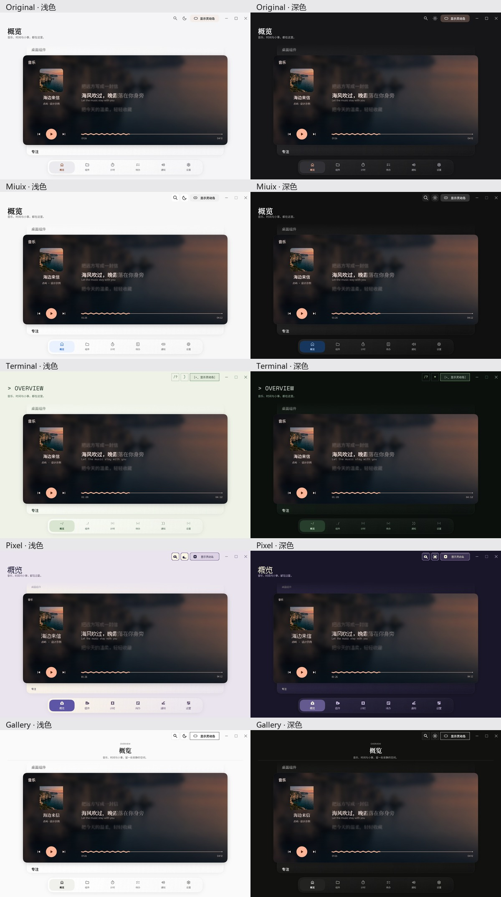
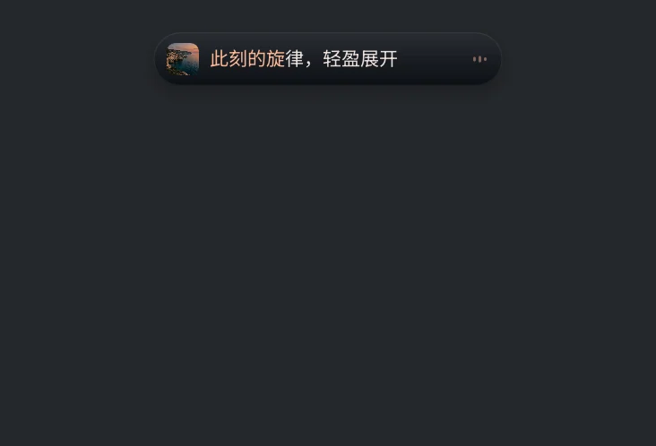

<picture>
  <source media="(prefers-color-scheme: dark)" srcset="docs/brand/dotisle-wordmark-light.svg">
  
</picture>

# 点屿 · DotIsle

**把音乐、歌词、专注与提醒，放进 Windows 桌面的一座小岛。**

音乐控制与实时歌词 · 番茄钟与计时 · 待办提醒 · 通知与设备

[下载安装版](https://github.com/Heiamer/DotIsle/releases/download/v3.2.6/DotIsle-3.2.6-Setup.exe) · [下载便携版](https://github.com/Heiamer/DotIsle/releases/download/v3.2.6/DotIsle-3.2.6-Portable.zip) · [3.2.6 更新说明](https://github.com/Heiamer/DotIsle/releases/tag/v3.2.6) · [反馈问题](https://github.com/Heiamer/DotIsle/issues)

Windows 10 / 11 · x64 · Rust 原生应用

## 桌面组件

十五类组件支持独立放置和内容配置：时钟、日历、待办、专注计时、音乐、系统状态，以及便签、纪念日倒数、天气、今日概览、电量、存储空间、世界时钟、快捷启动、专注统计。组件表面保持简洁，右键即可编辑、调整尺寸或移除。

番茄钟、倒计时和流程阶段支持胶囊液体进度；经典岛的音乐、计时和更新光效均为可选功能，默认关闭。

## 五套主题，同一套功能

截图来自应用原生渲染；歌曲、歌词与待办为演示数据。点击图片可查看大图。

| 主题 | 风格 |
| --- | --- |
| **默认** | 保留原有配色、布局、图标和窗口行为。 |
| **MIUIX** | 白色分组、连续圆角、蓝色强调和轻量交互，支持原云瓷配置迁移。 |
| **终端 · TTY** | 等宽字符、方正面板、块状进度与原始专辑封面。 |
| **像素 · Pixel** | 中英像素字体、方块图标与阶梯边框，专辑封面保留原图。 |
| **留白 · Gallery** | 黑白纸色、居中衬线标题与克制的画廊排版，兼容旧 Swiss 配置。 |

在 **控制中心 → 设置 → 外观** 选择主题。五个选项块支持点击、拖动和键盘切换，重启后保留选择；四套非默认主题使用固定窗口尺寸。

### 专辑封面，原样呈现

所有主题都直接显示播放器提供的原始封面。终端与像素主题保留各自的字体、图标和控件风格，图片不再经过 ASCII、像素化、RGB565 或调色板滤镜。

播放进度继续用**已播实心块、未播空心块**区分。切歌或封面延迟到达后自动刷新，缺少图片时才显示占位图。

### 用自己的图片做背景

在同一页面的 **自定义图片背景** 中选择本机 PNG、JPEG 或 BMP，可分别调整图片透明度、明暗、磨砂度，以及填满 / 适应方式。

每套主题单独保存图片和参数。导入图片会复制到本机数据目录，不上传服务器；关闭背景时仍保留配置，也可恢复默认。背景功能默认关闭。

### 更柔和的展开与收起

展开、收起时加入轻微高斯模糊，静止后恢复清晰；中途反向也能连续过渡。开启“减少动态效果”后关闭过渡模糊。

## 下载与开始使用

最新正式版：**[3.2.6](https://github.com/Heiamer/DotIsle/releases/tag/v3.2.6)**。发行包由 [GitHub Actions](https://github.com/Heiamer/DotIsle/actions/workflows/windows-release.yml) 编译，运行时不需要安装 Rust、Python 或 .NET。

| 文件 | 用途 |
| --- | --- |
| [安装版 · Setup.exe](https://github.com/Heiamer/DotIsle/releases/download/v3.2.6/DotIsle-3.2.6-Setup.exe) | 推荐使用。标准安装向导，支持开始菜单与卸载。 |
| [便携版 · Portable.zip](https://github.com/Heiamer/DotIsle/releases/download/v3.2.6/DotIsle-3.2.6-Portable.zip) | 免安装，完整解压后运行 `LyricIsland.exe`。 |
| [完整源码 · Source.zip](https://github.com/Heiamer/DotIsle/releases/download/v3.2.6/DotIsle-3.2.6-Source.zip) | 对应发行构建的源码、资源与第三方许可。 |
| [SHA256 校验清单](https://github.com/Heiamer/DotIsle/releases/download/v3.2.6/DotIsle-3.2.6-SHA256.txt) | 校验下载文件是否完整。 |
| [验证记录 · Validation.zip](https://github.com/Heiamer/DotIsle/releases/download/v3.2.6/DotIsle-3.2.6-Validation.zip) | Actions 中的控制中心与主题渲染验收记录。 |

1. 安装，或把便携包**完整解压到可写目录**；不要在压缩包内直接启动 EXE。
2. 运行点屿，从系统托盘打开控制中心。
3. 打开播放器并播放音乐，点屿会尝试连接媒体会话、读取歌曲并匹配歌词。
4. 在控制中心调整灵动岛排版、主题、图片背景与动画；也可直接使用计时和待办。

请保留程序旁的资源、字体、更新助手和许可证。关闭控制中心后，灵动岛继续运行；完全退出主程序后，不再提供计时和待办提醒。

### 从旧版更新

在“关于与更新”检查更新，或手动下载新包。手动迁移时先退出旧版，备份并复制原运行目录的 `Data` 到新目录；不要同时运行两个版本操作同一份数据。

发行页中的 `LyricIsland-3.2.6-Portable.zip` 与对应 SHA256 文件供旧更新器识别，日常下载请使用上表的 DotIsle 包。国内镜像可能晚于 GitHub 更新。

## 能做什么

- **音乐与歌词**：播放 / 暂停、切歌、进度调节、原文与翻译、多种展开排版、封面动态配色。实际控制能力取决于播放器接口。
- **专注与计时**：番茄钟、倒计时、秒表和流程计时，支持多项目与暂停恢复。
- **待办与提醒**：记录、编辑、完成、撤销，以及日期和时间提醒。
- **通知与设备**：在岛体中展示通知与设备连接状态，具体能力受系统、权限及设备接口影响。
- **外观与交互**：五套主题、独立图片背景、明暗模式、灵动岛布局与动画设置。

## 3.2.6 更新

网易云进度改为自动识别 x86/x64 原生结构，移除单客户端 DLL 哈希白名单，扩大 2.x 和 3.x 覆盖。普通启动即可自动连接，后台拖动按实际底栏控件和客户端资源定位，适配不同进度布局与 DPI。

8 个客户端二进制样本分别检查原生结构与界面资源，本机当前客户端另做真实控制验收。详细范围见 [兼容验证记录](docs/verification/3.2.6-compatibility.json) 和 [网易云连接说明](NETEASE-SEEKFIX.md)。静态检查不代表旧客户端全部功能均已运行实测；未知未来结构仍需验证。

## 源码与构建

使用 **Rust、Win32、Vello Hybrid、wgpu 与 Parley**。源码包含发行所需字体、资源和第三方补丁，不包含用户数据或编译缓存。

推荐使用仓库的 [Windows Release 工作流](.github/workflows/windows-release.yml) 构建；本地环境与命令见 **[3.2.6 构建说明](BUILD-3.2.6.md)**。本版通过 412 项工作区测试与 9 项页面读取检查，以及主题、背景和控制中心渲染检查；自动检查不能替代所有播放器与桌面交互场景的实机验证。

## 许可与反馈

项目许可见 [LICENSE](LICENSE)。第三方与字体许可见 [THIRD-PARTY-NOTICES.md](THIRD-PARTY-NOTICES.md)、[FONT-NOTICE.md](FONT-NOTICE.md) 和 [licenses](licenses/)。像素字体使用 Fusion Pixel，随包保留其许可。

欢迎在 [Issues](https://github.com/Heiamer/DotIsle/issues) 提交问题或建议。请附 Windows 版本、点屿版本、播放器版本、复现步骤和相关截图；分享日志前请移除个人信息。
